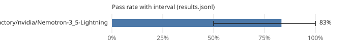

# Leaderboard: mini-science

- Results: [`results.jsonl`](results.jsonl) (6 runs, 6 tasks, seeds [0])
- Command: `ssw bench run --suite mini-science --workers tokenfactory/nvidia/Nemotron-3_5-Lightning --seeds 1 --budget-usd 0.5 --budget-usd-total 0.25 --allow-remote --policy bench/policies/tokenfactory-ladder.toml`
- Hardware: os Windows, arch x86_64, cpu_cores 32, ram_gb 1098.43, gpus 4, gpu_memory_gb [51.53, 48.31, 51.53, 51.53]
- Date: 2026-10-28T03:36:47+00:00
- Version: 0.1.0.dev0 (commit 46a3eb44ae5f)
- Pass-rate intervals: 95%, cluster bootstrap over tasks (10,000 resamples, seed 0); Wilson score interval with one task.
- Scoring: a run passes when every acceptance command exits with 0 on a fresh copy with the run's diff applied and the suite's protected paths restored.

| Rank | Contestant | Pass rate | 95% interval | Runs | Median wall (s) | Median tokens | Median uncached | Median hosted | GPU-s | Escalations | Cache hits | Changed tests | Reference cost |
|---:|---|---:|---:|---:|---:|---:|---:|---:|---:|---:|---:|---:|---:|
| 1 | tokenfactory/nvidia/Nemotron-3_5-Lightning | 83% | 50% to 100% | 6 | 59.1 | 137,881 | 69,884 | 137,881 | 0.0 | 0% | 59% | 0 | - |

